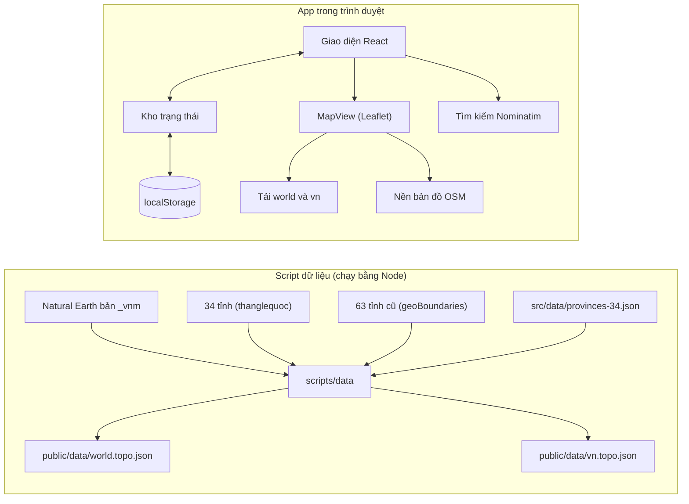

# Thiết kế chi tiết: Bản đồ hành trình

| Mục | Nội dung |
|---|---|
| Phiên bản | 0.1 |
| Ngày | 19/11/2026 |
| Trạng thái | Chờ duyệt |
| Thư mục dự án | `D:\Side\travel-map` (cần bạn xác nhận) |

## 1. Mục tiêu và phạm vi

App là một trang web bản đồ tương tác. Người dùng dùng app để đánh dấu các quốc gia và tỉnh thành đã đến hoặc muốn đến. Người dùng cũng ghim được các địa điểm du lịch.

App có một bản đồ thế giới duy nhất. Khi zoom vào Việt Nam, bản đồ hiện 34 tỉnh mới. Ranh giới 63 tỉnh cũ hiện thành nét đứt mờ để người dùng tham khảo.

Phiên bản đầu không có các phần sau:

- Tài khoản và server.
- Tải ảnh lên.
- Chia sẻ bằng link.
- Đưa web lên mạng.
- Chế độ tối (dark mode).
- Ngôn ngữ khác ngoài tiếng Việt.

## 2. Các quyết định đã chốt

| Chủ đề | Quyết định |
|---|---|
| Công nghệ | React, Vite và TypeScript. App dùng `leaflet` trực tiếp, không dùng `react-leaflet`. |
| Nơi lưu dữ liệu | `localStorage` của trình duyệt. Người dùng sao lưu bằng cách xuất và nhập file JSON. |
| Cách hiện bản đồ | Một bản đồ thế giới. Từ zoom 5 trở lên, Việt Nam tách thành 34 tỉnh mới. |
| Cấp tương tác | Người dùng chỉ rê chuột, bấm và đánh dấu ở cấp quốc gia và cấp 34 tỉnh. |
| Tỉnh cũ | Tỉnh cũ chỉ để xem thông tin. Viền tỉnh cũ là nét đứt mờ và không bấm được. Popup tỉnh mới liệt kê các tỉnh cũ. Popup ghim ghi tên tỉnh cũ. |
| Chủ quyền | Hoàng Sa thuộc Đà Nẵng. Trường Sa thuộc Khánh Hòa. Dữ liệu thế giới dùng bản Natural Earth theo góc nhìn Việt Nam. |
| Git | Chưa chạy `git init`. Mình chỉ chạy khi bạn bảo. |

## 3. Kiến trúc tổng quan

App có hai phần tách biệt.

- Phần thứ nhất là script xử lý dữ liệu. Script chạy bằng Node trên máy lập trình. Script đọc dữ liệu nguồn rồi tạo ra các file bản đồ đã giản lược.
- Phần thứ hai là app chạy trong trình duyệt. App tải các file bản đồ đó, vẽ bản đồ và lưu dữ liệu đánh dấu vào `localStorage`.

App không có server riêng. Sau khi build, app chỉ là các file tĩnh.



## 4. Cấu trúc thư mục

```
travel-map/
  docs/
    DESIGN.md              tài liệu này
  scripts/
    data/
      .cache/              dữ liệu nguồn đã tải, không đưa vào git
      download.ts          tải dữ liệu nguồn và kiểm tra checksum
      build-world.ts       tạo world.topo.json
      build-vietnam.ts     tạo vn.topo.json
      old-names.json       bảng sửa tên tỉnh cũ của geoBoundaries
      verify.test.ts       test kiểm tra dữ liệu đầu ra
  public/
    data/
      world.topo.json
      vn.topo.json
  src/
    main.tsx
    App.tsx
    data/
      provinces-34.json    bảng tham chiếu 34 tỉnh và 63 tỉnh cũ
      provinces.ts         hàm đọc bảng tham chiếu
    domain/
      types.ts             kiểu dữ liệu
      store.ts             reducer và các action
      vietnam.ts           tính trạng thái Việt Nam từ 34 tỉnh
      stats.ts             tính số liệu thống kê
      locate.ts            tìm quốc gia, tỉnh mới, tỉnh cũ của một tọa độ
      storage.ts           đọc và ghi localStorage
      importExport.ts      xuất và nhập file JSON
      schema.ts            schema zod để kiểm tra dữ liệu
    map/
      MapView.tsx          khung chứa bản đồ
      useLeafletMap.ts     tạo và hủy đối tượng Leaflet
      zoom.ts              hằng số mốc zoom và hàm đổi lớp
      styles.ts            màu và kiểu vẽ
      layers/
        countries.ts
        vietnamProvinces.ts
        oldBorders.ts
        islandLabels.ts
        places.ts
    services/
      nominatim.ts         gọi API tìm kiếm có giới hạn tốc độ
    ui/
      TopBar.tsx
      SearchBox.tsx
      SidePanel.tsx
      StatsCards.tsx
      Legend.tsx
      PlaceList.tsx
      CountryDetail.tsx
      ProvinceDetail.tsx
      VietnamDetail.tsx
      PlaceDetail.tsx
      PlaceForm.tsx
      ImportDialog.tsx
      BottomSheet.tsx
      Toast.tsx
    styles/
      tokens.css
  index.html
  package.json
  vite.config.ts
  tsconfig.json
```

Test của từng module nằm cạnh module, ví dụ `src/domain/vietnam.test.ts`.

## 5. Dữ liệu bản đồ

### 5.1. Nguồn dữ liệu

| Dữ liệu | Nguồn | Giấy phép | Ghi chú |
|---|---|---|---|
| Các quốc gia | `ne_10m_admin_0_countries_vnm.geojson` trong repo [nvkelso/natural-earth-vector](https://github.com/nvkelso/natural-earth-vector) | Public domain | File có 248 vùng. Mình đã kiểm tra rằng 7 đảo Hoàng Sa và 12 đảo Trường Sa thuộc vùng `VNM`. |
| 34 tỉnh mới | Thư mục `resources/gis/geojson_11Mar2026` trong repo [thanglequoc/vietnamese-provinces-database](https://github.com/thanglequoc/vietnamese-provinces-database) | MIT | Mỗi tỉnh có một file `province.geojson`. File chỉ có thuộc tính `matinh`. File không có Hoàng Sa và Trường Sa. |
| Tên và tỉnh cũ của 34 tỉnh | File `bando_co_dvch.sql` trong cùng repo trên, và [Nghị quyết 202/2025/QH15](https://static3.luatvietnam.vn/uploaded/vietlawfile/2025/6/202_2025_qh15_130625135937.pdf) | MIT, văn bản pháp luật | Cột `truocsapnhap` ghi các tỉnh cũ của mỗi tỉnh mới. |
| Mã tỉnh mới | [Quyết định 19/2025/QĐ-TTg](https://www.nso.gov.vn/default/2025/07/quyet-dinh-ban-hanh-bang-danh-muc-va-ma-so-cac-don-vi-hanh-chinh-viet-nam/) | Văn bản pháp luật | Mã gồm 2 chữ số, ví dụ `79` là TP. Hồ Chí Minh. |
| 63 tỉnh cũ | [geoBoundaries VNM ADM1](https://www.geoboundaries.org/api/current/gbOpen/VNM/ADM1/) | Public Domain | File có 64 vùng vì Côn Đảo tách riêng. Tên có lỗi nhỏ. Dữ liệu vẽ theo ranh giới năm 2008. |

### 5.2. Ba cái bẫy đã phát hiện khi kiểm tra dữ liệu

- **Số trên tên thư mục khác mã trong file.** Ví dụ, thư mục `2_tinh_cao_bang` có `matinh` là `7`. Thư mục `12_tinh_bac_ninh` có `matinh` là `2`. Vì vậy script phải nối bằng `matinh` qua cột `bandoId` của bảng tham chiếu. Script không được dựa vào tên thư mục.
- **Mã tỉnh mới và mã tỉnh cũ trùng nhau.** Ví dụ, mã `24` là Bắc Ninh mới, nhưng cũng là Bắc Giang cũ. Mã `79` là TP. Hồ Chí Minh ở cả hai danh sách. Vì vậy code luôn tách hai trường `code` và `oldCode`. Code không bao giờ dùng chung một kiểu dữ liệu cho hai loại mã.
- **Natural Earth ghi `ISO_A3` là `-99` cho một số nước**, ví dụ Pháp và Na Uy. Vì vậy app dùng trường `ADM0_A3` làm khóa quốc gia.

### 5.3. Bảng tham chiếu `provinces-34.json`

Đây là nguồn sự thật duy nhất về tên tỉnh, mã tỉnh và quan hệ giữa tỉnh mới với tỉnh cũ. Cả script dữ liệu lẫn app đều đọc file này.

```json
[
  {
    "code": "79",
    "name": "Hồ Chí Minh",
    "kind": "thanh-pho",
    "bandoId": "29",
    "oldProvinces": [
      { "oldCode": "74", "name": "Bình Dương", "kind": "tinh" },
      { "oldCode": "77", "name": "Bà Rịa - Vũng Tàu", "kind": "tinh" },
      { "oldCode": "79", "name": "Hồ Chí Minh", "kind": "thanh-pho" }
    ]
  }
]
```

Tên hiển thị được ghép theo quy tắc sau. Nếu `kind` là `thanh-pho`, app thêm tiền tố "TP." vào trước tên. Nếu `kind` là `tinh`, app hiện tên như cũ. Ví dụ, app hiện "TP. Hồ Chí Minh" và "Bình Dương".

Bảng đầy đủ nằm ở mục 14.

### 5.4. Quy trình xử lý dữ liệu

Script chạy bằng lệnh `npm run data`. Script gồm các bước sau.

**Bước A. Tải dữ liệu nguồn.** Script tải các file nguồn vào `scripts/data/.cache`. Script ghi lại checksum SHA-256 của từng file. Nếu nguồn thay đổi ở lần tải sau, script báo cho người chạy biết.

**Bước B. Tạo lớp thế giới.**

1. Script đọc file Natural Earth bản `_vnm`.
2. Script chỉ giữ ba thuộc tính. Đó là `id` (lấy từ `ADM0_A3`), `name` (lấy từ `NAME_VI`) và `nameEn` (lấy từ `NAME`).
3. Script giản lược hình dạng bằng `mapshaper`. Script bật tùy chọn `keep-shapes` để các đảo nhỏ không bị xóa mất.
4. Script làm tròn tọa độ đến 4 chữ số thập phân. Mức này tương đương khoảng 11 mét.

**Bước C. Tách Hoàng Sa và Trường Sa.**

1. Script lấy vùng `VNM` trong file Natural Earth.
2. Script lấy các mảnh có tâm nằm trong khung kinh độ 111 đến 113, vĩ độ 15,5 đến 17,5. Đây là Hoàng Sa.
3. Script lấy các mảnh có tâm nằm trong khung kinh độ 111 đến 117, vĩ độ 6 đến 12. Đây là Trường Sa.

**Bước D. Tạo lớp 34 tỉnh.**

1. Script đọc 34 file `province.geojson`.
2. Script nối mỗi file với bảng tham chiếu qua `matinh` và `bandoId`.
3. Script gộp Hoàng Sa vào tỉnh mã `48` (Đà Nẵng).
4. Script gộp Trường Sa vào tỉnh mã `56` (Khánh Hòa).
5. Script giản lược hình dạng và làm tròn tọa độ như bước B.
6. Mỗi tỉnh trong file đầu ra có hai thuộc tính là `code` và `name`.

**Bước E. Tạo lớp tỉnh cũ.**

1. Script đọc file geoBoundaries.
2. Script sửa tên theo `old-names.json`. Ví dụ, "Ho Chi Minh" thành "Hồ Chí Minh". Script cũng xóa ký tự tab trong "Hà Nội" và đổi gạch nối dài trong "Bà Rịa–Vũng Tàu" thành gạch nối thường.
3. Script gộp vùng Côn Đảo vào Bà Rịa - Vũng Tàu (mã cũ `77`).
4. Script gán `oldCode` và `code` cho từng tỉnh cũ theo bảng tham chiếu.
5. Script chia tỉnh cũ thành 34 nhóm theo `code`. Sau đó script cắt mỗi nhóm theo đúng đường viền tỉnh mới của nhóm. Nhờ vậy, bờ biển và đường viền ngoài luôn lấy từ dữ liệu 34 tỉnh.
6. Script tạo các đường chia bên trong bằng lệnh `mapshaper -innerlines`. Script chỉ giữ đường nằm giữa hai tỉnh cũ có cùng `code`.

**Bước F. Ghi file đầu ra.** Script ghi hai file TopoJSON vào `public/data`.

| File | Đối tượng bên trong | Thuộc tính |
|---|---|---|
| `world.topo.json` | `countries` (vùng) | `id`, `name`, `nameEn` |
| `vn.topo.json` | `provinces` (vùng) | `code`, `name` |
| | `oldProvinces` (vùng, chỉ dùng để tra cứu) | `oldCode`, `code` |
| | `oldBorders` (đường) | `code` |

**Bước G. Kiểm tra.** Script chạy `verify.test.ts`. Danh sách test nằm ở mục 11.1.

### 5.5. Ngân sách dung lượng

| File | Giới hạn trước khi nén |
|---|---|
| `world.topo.json` | 700 KB |
| `vn.topo.json` | 700 KB |
| Tổng | 1,5 MB |

Nếu file vượt giới hạn, mình tăng mức giản lược. Sau đó mình chụp ảnh so sánh để bạn duyệt độ chi tiết.

## 6. Dữ liệu người dùng

### 6.1. Kiểu dữ liệu

```ts
type CountryId = string;        // ADM0_A3, ví dụ "JPN"
type ProvinceCode = string;     // mã tỉnh mới, ví dụ "79"
type OldProvinceCode = string;  // mã tỉnh cũ, ví dụ "74"

type MarkStatus = 'visited' | 'wishlist';

interface Mark {
  status: MarkStatus;
  date?: string;       // dạng "YYYY-MM", ví dụ "2024-03"
  note?: string;       // tối đa 1000 ký tự
  updatedAt: string;   // ISO 8601
}

interface Place {
  id: string;          // crypto.randomUUID()
  name: string;        // 1 đến 120 ký tự
  lat: number;         // -90 đến 90
  lng: number;         // -180 đến 180
  status: MarkStatus;
  date?: string;
  note?: string;
  createdAt: string;
  updatedAt: string;
}

interface UserData {
  schemaVersion: 1;
  countries: Record<CountryId, Mark>;
  provinces: Record<ProvinceCode, Mark>;
  places: Place[];
}
```

### 6.2. Quy tắc dữ liệu

- `countries` không bao giờ chứa khóa `VNM`. Trạng thái của Việt Nam luôn được tính từ `provinces`.
- Một vùng không có trong `countries` hoặc `provinces` nghĩa là vùng đó chưa được đánh dấu.
- Ghim không lưu quốc gia, tỉnh mới hay tỉnh cũ. App tính các giá trị này từ tọa độ mỗi khi cần. Nhờ vậy, khi dữ liệu bản đồ được cải thiện, kết quả tự đúng theo.
- App kiểm tra mọi dữ liệu đọc vào bằng schema `zod`. Việc kiểm tra áp dụng cho cả `localStorage` lẫn file nhập.

### 6.3. Lưu vào `localStorage`

| Khóa | Nội dung |
|---|---|
| `travel-map:data` | `UserData` dạng JSON |
| `travel-map:backup` | Bản dữ liệu ngay trước lần nhập file gần nhất |
| `travel-map:view` | Tâm và mức zoom lần cuối của bản đồ |

- App ghi dữ liệu sau mỗi thay đổi, với độ trễ 300 ms để gom các thay đổi liên tiếp.
- Nếu trình duyệt chặn `localStorage`, app vẫn chạy bằng bộ nhớ tạm. App hiện một dải cảnh báo. Dải này nói rằng dữ liệu sẽ mất khi đóng tab và gợi ý người dùng xuất file.
- Nếu dữ liệu trong `localStorage` bị hỏng, app không xóa nó. App chép chuỗi hỏng sang khóa `travel-map:corrupt` rồi bắt đầu với dữ liệu rỗng. App báo cho người dùng biết việc này.
- Khi người dùng mở app ở hai tab, app nghe sự kiện `storage`. Khi tab kia ghi dữ liệu mới, tab này nạp lại dữ liệu đó.

### 6.4. Xuất và nhập file

File xuất có dạng sau.

```json
{
  "app": "travel-map",
  "schemaVersion": 1,
  "exportedAt": "2026-11-19T10:00:00.000Z",
  "data": { "schemaVersion": 1, "countries": {}, "provinces": {}, "places": [] }
}
```

Tên file có dạng `ban-do-hanh-trinh-2026-11-19.json`.

Luồng nhập file gồm các bước sau.

1. Người dùng chọn file.
2. App đọc file và kiểm tra bằng schema.
3. Nếu file lỗi, app báo lỗi cụ thể và không đổi dữ liệu hiện tại.
4. Nếu file hợp lệ, app hiện hộp xác nhận. Hộp này ghi số quốc gia, số tỉnh và số ghim trong file. Hộp cũng nói rõ dữ liệu hiện tại sẽ bị thay thế.
5. Khi người dùng xác nhận, app chép dữ liệu hiện tại sang `travel-map:backup`. Sau đó app thay bằng dữ liệu trong file.
6. App hiện thông báo kèm nút "Hoàn tác" trong 10 giây.

Phiên bản đầu chỉ có chế độ thay thế. App chưa có chế độ gộp hai bộ dữ liệu.

### 6.5. Nâng cấp phiên bản dữ liệu

- Mỗi bộ dữ liệu có trường `schemaVersion`.
- File `schema.ts` chứa một bảng hàm nâng cấp. Mỗi hàm nâng dữ liệu lên một phiên bản.
- Nếu file có `schemaVersion` lớn hơn phiên bản app hiểu, app từ chối nhập. App báo rằng file được tạo bởi phiên bản app mới hơn.

## 7. Bản đồ

### 7.1. Cấu hình Leaflet

| Thiết lập | Giá trị | Lý do |
|---|---|---|
| `minZoom` | 2 | Ở mức này cả thế giới vừa màn hình. |
| `maxZoom` | 17 | Đủ để đặt ghim chính xác đến từng con phố. |
| `worldCopyJump` | `true` | Ghim và vùng không bị lệch khi kéo qua kinh tuyến 180. |
| `maxBounds` | vĩ độ -85 đến 85 | Người dùng không kéo được ra ngoài bản đồ. |
| `preferCanvas` | `true` | Vẽ hàng trăm vùng bằng canvas nhanh hơn SVG. |
| Góc nhìn ban đầu | tâm `[20, 100]`, zoom 2 | App dùng góc nhìn lần cuối nếu đã lưu. |

### 7.2. Thứ tự các lớp

| Pane | z-index | Nội dung | Bấm được |
|---|---|---|---|
| `tilePane` | 200 | Nền OpenStreetMap | Không |
| `countries` | 400 | Các quốc gia | Có |
| `vnProvinces` | 410 | 34 tỉnh | Có |
| `oldBorders` | 420 | Nét đứt tỉnh cũ | Không |
| `islandLabels` | 430 | Nhãn Hoàng Sa và Trường Sa | Không |
| `markerPane` | 600 | Ghim và nhóm ghim | Có |
| `popupPane` | 700 | Popup | Có |

### 7.3. Đổi lớp theo mức zoom

Hằng số `VN_DETAIL_ZOOM` bằng 5. Mình sẽ chỉnh con số này ở bước F2 nếu cần.

| Lớp | Zoom nhỏ hơn 5 | Zoom từ 5 trở lên |
|---|---|---|
| Các quốc gia khác Việt Nam | Hiện | Hiện |
| Việt Nam dạng một vùng | Hiện | Ẩn |
| 34 tỉnh | Ẩn | Hiện |
| Nét đứt tỉnh cũ | Ẩn | Hiện |
| Nhãn Hoàng Sa và Trường Sa | Ẩn | Hiện |

App nghe sự kiện `zoomend` để bật hoặc tắt các lớp. Việt Nam được tách thành một lớp riêng, vì Leaflet không đổi được khả năng bấm của từng vùng sau khi đã tạo.

### 7.4. Kiểu vẽ

| Trạng thái | Màu nền | Độ đậm nền | Viền |
|---|---|---|---|
| Chưa đánh dấu | trong suốt | 0 | `#8A8F98`, dày 0,8 px |
| Đã đến | `#3FA36B` | 0,55 | `#2F7D52`, dày 0,8 px |
| Muốn đến | `#F0A33A` | 0,55 | `#B87717`, dày 0,8 px |
| Đang rê chuột | giữ màu nền | tăng thêm 0,15 | `#2563EB`, dày 2 px |
| Đang chọn | giữ màu nền | giữ nguyên | `#2563EB`, dày 2,5 px |
| Nét đứt tỉnh cũ | không có | không có | `#6B7280`, dày 1 px, độ đậm 0,6, kiểu nét `4 4` |

Vùng chưa đánh dấu có nền trong suốt nhưng vẫn bấm được. Lý do là Leaflet dùng hình học để xác định vùng được bấm, chứ không dùng màu.

### 7.5. Nhãn Hoàng Sa và Trường Sa

Đảo ở hai quần đảo rất nhỏ. Ở zoom 5 đến 8, các đảo gần như không nhìn thấy. Vì vậy app đặt hai nhãn cố định.

| Nhãn | Vị trí gần đúng |
|---|---|
| Quần đảo Hoàng Sa (Đà Nẵng) | vĩ độ 16,5, kinh độ 112,0 |
| Quần đảo Trường Sa (Khánh Hòa) | vĩ độ 10,0, kinh độ 114,0 |

Script dữ liệu sẽ tính vị trí chính xác từ tâm của các đảo.

### 7.6. Ghim

- App dùng `leaflet.markercluster` để gom các ghim gần nhau.
- Từ zoom 9 trở lên, app ngừng gom và hiện từng ghim.
- Ghim là biểu tượng SVG. Ghim "Đã đến" màu xanh lá. Ghim "Muốn đến" màu cam.

### 7.7. Nối Leaflet với React

- Hook `useLeafletMap` tạo đối tượng bản đồ đúng một lần khi component được gắn vào trang. Hook hủy bản đồ khi component bị gỡ.
- Mỗi lớp trong `map/layers` giữ một bảng tra từ mã vùng sang đối tượng Leaflet.
- Khi dữ liệu người dùng đổi, React gọi hàm `update` của lớp. Hàm này chỉ đổi kiểu vẽ của các vùng có thay đổi. Hàm không vẽ lại cả lớp.
- Trên máy tính, nội dung popup là component React. App gắn component này vào khung popup của Leaflet bằng `createPortal`.
- Trên điện thoại, app không mở popup của Leaflet. App mở khung kéo từ dưới lên và hiện cùng component đó.

## 8. Giao diện

### 8.1. Bố cục theo kích thước màn hình

| Chiều rộng | Bố cục |
|---|---|
| Từ 1024 px trở lên | Thanh trên cùng cao 56 px. Khung bên trái rộng 300 px và luôn mở. Bản đồ chiếm phần còn lại. |
| Từ 600 đến 1023 px | Khung bên trái thành lớp phủ rộng 300 px. Người dùng mở hoặc đóng khung bằng nút menu. |
| Dưới 600 px | Khung bên trái thành khung kéo từ dưới lên. Khung có ba nấc là thu gọn (64 px), nửa màn hình và gần toàn màn hình. |

Hình dưới đây là bố cục trên máy tính.

```
+---------------------------------------------------------------+
| Bản đồ hành trình | [Tìm địa điểm............] | Xuất | Nhập   |
+------------------+--------------------------------------------+
| Thống kê         |                                            |
|  Quốc gia   7    |                                            |
|  Tỉnh   20/34    |              BẢN ĐỒ                        |
|  Địa điểm  12    |                         +---------------+  |
| Chú thích        |                         | Popup         |  |
|  Đã đến          |                         +---------------+  |
|  Muốn đến        |                                            |
|  Chưa đánh dấu   |                                            |
|  - - Tỉnh cũ     |                                            |
| Địa điểm         |                                            |
|  [+ Thêm]        |                                            |
|  Phố cổ Hội An   |                                            |
+------------------+--------------------------------------------+
```

Hình dưới đây là bố cục trên điện thoại.

```
+---------------------------+
| [=] [Tìm địa điểm.....]   |
|                           |
|         BẢN ĐỒ            |
|                           |
+---------------------------+
| ---                       |
| 7 quốc gia · 20/34 tỉnh   |  <- khung kéo, nấc thu gọn
+---------------------------+
```

### 8.2. Các component

| Component | Nhiệm vụ |
|---|---|
| `App` | Giữ kho trạng thái, tải dữ liệu bản đồ, chọn bố cục theo kích thước màn hình. |
| `TopBar` | Hiện tên app, ô tìm kiếm, nút Xuất và nút Nhập. |
| `SearchBox` | Gửi truy vấn khi bấm Enter. Hiện tối đa 5 kết quả. |
| `SidePanel` | Chứa `StatsCards`, `Legend` và `PlaceList`. |
| `StatsCards` | Hiện số quốc gia đã đến, số tỉnh đã đến trên 34 và số ghim. |
| `Legend` | Giải thích màu và nét đứt. |
| `PlaceList` | Liệt kê ghim, mới nhất ở trên. Bấm một dòng thì bản đồ bay tới ghim đó. |
| `CountryDetail` | Nội dung popup của một quốc gia khác Việt Nam. |
| `VietnamDetail` | Nội dung popup của Việt Nam khi zoom nhỏ hơn 5. Popup hiện tiến độ và nút "Phóng to Việt Nam". |
| `ProvinceDetail` | Nội dung popup của một tỉnh. Popup có nút trạng thái, ngày đến, ghi chú và danh sách tỉnh cũ. |
| `PlaceDetail` | Nội dung popup của một ghim. Popup ghi ghim thuộc quốc gia nào, tỉnh nào và tỉnh cũ nào. |
| `PlaceForm` | Form thêm hoặc sửa ghim. |
| `ImportDialog` | Hộp xác nhận khi nhập file. |
| `BottomSheet` | Khung kéo từ dưới lên trên điện thoại. |
| `Toast` | Thông báo ngắn, có thể kèm nút "Hoàn tác". |

### 8.3. Các luồng tương tác

**Đánh dấu một quốc gia.**

1. Người dùng bấm vào một quốc gia khác Việt Nam.
2. Popup hiện tên quốc gia và hai nút "Đã đến" và "Muốn đến".
3. Người dùng bấm một nút. Quốc gia đổi màu ngay.
4. Khi đã có trạng thái, popup hiện thêm ô ngày đến và ô ghi chú.
5. Nếu người dùng bấm lại nút đang chọn, app bỏ đánh dấu. App hiện thông báo kèm nút "Hoàn tác" trong 5 giây.

**Xem Việt Nam ở mức thế giới.**

1. Người dùng bấm vào Việt Nam khi zoom nhỏ hơn 5.
2. Popup hiện "Đã đến 20/34 tỉnh" và nút "Phóng to Việt Nam".
3. Khi người dùng bấm nút, bản đồ bay tới khung bao của Việt Nam, kể cả hai quần đảo.

**Đánh dấu một tỉnh.**

1. Người dùng bấm vào một tỉnh khi zoom từ 5 trở lên.
2. Popup hiện tên tỉnh, nút trạng thái, ô ngày đến, ô ghi chú và danh sách tỉnh cũ.
3. Các bước còn lại giống luồng đánh dấu quốc gia.

**Thêm ghim bằng cách bấm lên bản đồ.**

1. Người dùng bấm nút "Thêm địa điểm".
2. Con trỏ đổi thành hình dấu cộng. Một dải hướng dẫn hiện ở đầu bản đồ.
3. Người dùng bấm lên bản đồ. Form thêm ghim mở ra.
4. Người dùng nhập tên và chọn trạng thái, rồi bấm "Lưu".
5. Phím Esc hủy thao tác ở bất kỳ bước nào.

**Thêm ghim bằng tìm kiếm.**

1. Người dùng gõ tên địa điểm rồi bấm Enter.
2. App hiện tối đa 5 kết quả.
3. Người dùng chọn một kết quả. Bản đồ bay tới đó.
4. Form thêm ghim mở ra với tên đã điền sẵn.

**Gợi ý đánh dấu vùng.** Sau khi lưu một ghim "Đã đến", app kiểm tra tỉnh hoặc quốc gia chứa ghim. Nếu vùng đó chưa được đánh dấu, app hiện thông báo "Đánh dấu Đà Nẵng là Đã đến?" kèm nút "Đánh dấu". App không tự đánh dấu.

**Sửa và xóa ghim.** Người dùng bấm vào ghim để mở popup. Popup có nút "Sửa" và nút "Xóa". Khi xóa, app hiện thông báo kèm nút "Hoàn tác" trong 5 giây.

### 8.4. Trạng thái lỗi và trạng thái rỗng

| Tình huống | App làm gì |
|---|---|
| Không tải được file bản đồ | App hiện thông báo lỗi toàn màn hình và nút "Thử lại". |
| Tìm kiếm không có kết quả | App hiện "Không tìm thấy địa điểm. Thử tên khác." |
| Dịch vụ tìm kiếm lỗi hoặc quá 8 giây | App hiện "Không kết nối được dịch vụ tìm kiếm. Thử lại sau." |
| `localStorage` bị chặn | App hiện dải cảnh báo như mục 6.3. |
| File nhập không hợp lệ | App hiện lý do cụ thể, ví dụ "File không phải của Bản đồ hành trình". |
| Chưa có ghim nào | `PlaceList` hiện "Ghim địa điểm đầu tiên của bạn" và nút "Thêm địa điểm". |

### 8.5. Khả năng truy cập

- Mọi nút đều có nhãn chữ hoặc `aria-label`.
- Mọi thành phần bấm được đều có viền khi được chọn bằng bàn phím.
- Phím Esc đóng popup, form và hộp xác nhận.
- Màu chữ đạt tỉ lệ tương phản tối thiểu 4,5:1.
- Phiên bản đầu chưa cho dùng bàn phím để chọn vùng trên bản đồ. Đây là giới hạn đã biết.

## 9. Dịch vụ bên ngoài

### 9.1. Tìm kiếm bằng Nominatim

- App gọi `https://nominatim.openstreetmap.org/search`.
- Tham số gồm `q`, `format=jsonv2`, `limit=5` và `accept-language=vi`.
- [Chính sách của Nominatim](https://operations.osmfoundation.org/policies/nominatim/) cho phép tối đa 1 yêu cầu mỗi giây. Chính sách cũng cấm tự gợi ý khi đang gõ. Vì vậy app chỉ gửi khi người dùng bấm Enter. Module `nominatim.ts` có hàng đợi để giữ khoảng cách tối thiểu 1 giây giữa hai yêu cầu.
- App lưu kết quả của các truy vấn gần đây trong bộ nhớ. Khi người dùng tìm lại cùng một chữ, app không gọi lại dịch vụ.
- Mỗi yêu cầu có thời hạn 8 giây. App hủy yêu cầu cũ khi người dùng tìm chữ mới.
- Chữ người dùng gõ vào ô tìm kiếm sẽ được gửi tới máy chủ OpenStreetMap. Đây là điều người dùng cần biết. App ghi một dòng nhỏ dưới ô tìm kiếm để nói rõ việc này.

### 9.2. Nền bản đồ OpenStreetMap

- App dùng `https://tile.openstreetmap.org/{z}/{x}/{y}.png`.
- App luôn hiện dòng ghi nguồn "© OpenStreetMap contributors" theo [chính sách dùng tile](https://operations.osmfoundation.org/policies/tiles/).
- Nền bản đồ có độ đậm 0,6 để màu đánh dấu nổi rõ hơn.

## 10. Các thuật toán chính

### 10.1. Tính trạng thái Việt Nam

```
nếu có ít nhất một tỉnh "Đã đến"      -> Việt Nam là "Đã đến"
ngược lại, nếu có tỉnh "Muốn đến"      -> Việt Nam là "Muốn đến"
ngược lại                              -> Việt Nam chưa đánh dấu
tiến độ = số tỉnh "Đã đến" / 34
```

### 10.2. Tìm vùng chứa một tọa độ

Hàm `locate(lat, lng)` trả về `{ countryId?, code?, oldCode? }`. Hàm chạy theo các bước sau.

1. Hàm lọc nhanh các quốc gia bằng khung bao.
2. Hàm kiểm tra điểm có nằm trong quốc gia nào bằng `@turf/boolean-point-in-polygon`.
3. Nếu quốc gia là `VNM`, hàm tìm tiếp tỉnh mới chứa điểm.
4. Nếu tỉnh mới chỉ có một tỉnh cũ, `oldCode` là mã của tỉnh cũ đó.
5. Nếu tỉnh mới có nhiều tỉnh cũ, hàm tìm tỉnh cũ chứa điểm.
6. Nếu điểm rơi vào chỗ hở giữa các tỉnh cũ, hàm chọn tỉnh cũ có đường viền gần điểm nhất. Hàm đo khoảng cách bằng `@turf/point-to-line-distance`.
7. Nếu điểm nằm trên biển và không thuộc quốc gia nào, hàm trả về kết quả rỗng. Popup ghim khi đó không ghi vùng.

### 10.3. Thống kê

| Số liệu | Cách tính |
|---|---|
| Quốc gia đã đến | Số khóa có trạng thái "Đã đến" trong `countries`, cộng 1 nếu Việt Nam là "Đã đến". |
| Tỉnh đã đến | Số khóa có trạng thái "Đã đến" trong `provinces`, trên tổng 34. |
| Địa điểm | Độ dài của `places`. |

App không hiện mẫu số cho số quốc gia. Lý do là tổng số quốc gia trên thế giới có nhiều cách đếm khác nhau.

## 11. Kiểm thử và xác minh

### 11.0. Các bước làm

Mình làm từng bước một. Sau mỗi bước, mình gửi bạn kết quả test và ảnh chụp. Khi bạn duyệt xong, mình mới làm bước tiếp theo.

| Bước | Nội dung | Module chính |
|---|---|---|
| F0 | Khung dự án gồm Vite, React, TypeScript và Vitest | `package.json`, `vite.config.ts`, `App.tsx` |
| F1 | Script chuẩn bị dữ liệu | `scripts/data`, `src/data/provinces-34.json` |
| F2 | Bản đồ thế giới zoom vào Việt Nam | `map/` |
| F3 | Đánh dấu quốc gia và tỉnh, popup có danh sách tỉnh cũ | `domain/store.ts`, `domain/vietnam.ts`, `ui/*Detail.tsx` |
| F4 | Ghim địa điểm bằng cách bấm lên bản đồ hoặc tìm kiếm | `domain/locate.ts`, `services/nominatim.ts`, `map/layers/places.ts`, `ui/PlaceForm.tsx` |
| F5 | Tự lưu, xuất và nhập file JSON | `domain/storage.ts`, `domain/importExport.ts`, `ui/ImportDialog.tsx` |
| F6 | Khung thống kê | `domain/stats.ts`, `ui/StatsCards.tsx` |
| F7 | Giao diện điện thoại | `ui/BottomSheet.tsx`, CSS |

Ở bước F0, lệnh `npm run dev` phải mở được trang. Lệnh `npm test` phải chạy qua một test mẫu. Lệnh `npm run build` không được báo lỗi.

### 11.1. Test dữ liệu (bước F1)

| Test | Điều kiện đạt |
|---|---|
| Đủ 34 tỉnh | `provinces` có đúng 34 vùng. Mã không trùng. Mã khớp với bảng tham chiếu. |
| Đủ 63 tỉnh cũ | Bảng tham chiếu có đúng 63 tỉnh cũ. Mã cũ không trùng. Mỗi tỉnh cũ thuộc đúng một tỉnh mới. |
| Tỉnh giữ nguyên | Có đúng 11 tỉnh mới chỉ gồm một tỉnh cũ. |
| Mã tỉnh mới đúng | Cả 34 mã khớp với Quyết định 19/2025/QĐ-TTg. |
| Nối geoBoundaries đủ | Cả 63 tỉnh cũ đều nối được tên. Côn Đảo đã gộp vào mã cũ `77`. |
| Hoàng Sa | Tâm của một đảo Hoàng Sa nằm trong tỉnh `48`. |
| Trường Sa | Tâm của một đảo Trường Sa nằm trong tỉnh `56`. |
| Vùng VNM thế giới | Vùng `VNM` trong `world.topo.json` chứa cả hai quần đảo. |
| Nét đứt nằm trong tỉnh | Mọi điểm của mỗi đường `oldBorders` nằm trong tỉnh mới của nó, sai lệch không quá 100 m. |
| Diện tích khớp | Với mỗi tỉnh mới, tổng diện tích các tỉnh cũ sau khi cắt đạt ít nhất 98% diện tích tỉnh mới. |
| Tên quốc gia | Mọi quốc gia có `id` không trùng và có `name` tiếng Việt. |
| Dung lượng | Đạt giới hạn ở mục 5.5. |

### 11.2. Unit test của app

| Module | Ca kiểm thử |
|---|---|
| `store.ts` | Đặt, đổi và bỏ trạng thái của quốc gia và tỉnh. Thêm, sửa và xóa ghim. Không bao giờ lưu khóa `VNM` vào `countries`. |
| `vietnam.ts` | Không có tỉnh nào. Chỉ có tỉnh "Muốn đến". Có cả hai loại. Đủ 34 tỉnh "Đã đến". |
| `stats.ts` | Các con số khớp với một bộ dữ liệu mẫu cố định. |
| `locate.ts` | Hội An cho ra `VNM`, tỉnh `48`, tỉnh cũ `49`. Thủ Dầu Một cho ra tỉnh `79`, tỉnh cũ `74`. Vũng Tàu cho ra tỉnh `79`, tỉnh cũ `77`. Hà Nội cho ra tỉnh `01`, tỉnh cũ `01`. Tokyo cho ra `JPN` và không có tỉnh. Một điểm giữa Thái Bình Dương cho ra kết quả rỗng. Một điểm trong chỗ hở cho ra tỉnh cũ gần nhất. |
| `storage.ts` | Đọc khi chưa có dữ liệu. Đọc khi dữ liệu hỏng. Ghi khi `localStorage` báo lỗi. |
| `importExport.ts` | Xuất rồi nhập lại cho dữ liệu giống hệt. Từ chối file không phải JSON. Từ chối file của app khác. Từ chối file có `schemaVersion` lớn hơn. Từ chối tọa độ ngoài phạm vi. Từ chối ghi chú dài hơn 1000 ký tự. |
| `nominatim.ts` | Hai yêu cầu liên tiếp cách nhau ít nhất 1 giây (dùng đồng hồ giả của Vitest). URL có `accept-language=vi`. Lỗi mạng trả về thông báo đúng. |

### 11.3. Kiểm tra trên trình duyệt

Mình kiểm tra bằng trình duyệt có sẵn trong ứng dụng Claude. Sau mỗi bước, mình gửi bạn ảnh chụp và kết quả.

| Bước | Thao tác | Kết quả mong đợi |
|---|---|---|
| F2 | Mở app | Bản đồ thế giới hiện ở zoom 2. Console không có lỗi. |
| F2 | Zoom tới 4 | Việt Nam vẫn là một vùng. |
| F2 | Zoom tới 5 | Việt Nam tách thành 34 tỉnh. Nét đứt tỉnh cũ hiện ra. Hai nhãn quần đảo hiện ra. |
| F2 | Rê chuột qua một tỉnh | Viền tỉnh sáng lên. Tên tỉnh hiện ra. |
| F2 | Bấm trúng một nét đứt | Popup của tỉnh mới mở ra. |
| F3 | Đánh dấu TP. Hồ Chí Minh là "Đã đến" | Tỉnh đổi màu xanh. Popup liệt kê 3 tỉnh cũ. |
| F3 | Zoom ra mức 4 | Việt Nam có màu xanh. Popup Việt Nam ghi "1/34". |
| F3 | Bấm lại nút "Đã đến" | Tỉnh mất màu. Thông báo "Hoàn tác" hiện ra. Bấm "Hoàn tác" thì màu trở lại. |
| F4 | Tìm "Hội An" rồi thêm ghim | Ghim hiện đúng chỗ. Popup ghim ghi "Đà Nẵng, Quảng Nam cũ". |
| F4 | Tải lại trang | Ghim vẫn còn. |
| F4 | Zoom ra mức 3 | Các ghim gần nhau gom thành một nhóm có số đếm. |
| F5 | Xuất file, xóa dữ liệu, nhập lại | Dữ liệu trở lại đầy đủ. |
| F5 | Nhập một file hỏng | App báo lỗi. Dữ liệu hiện tại không đổi. |
| F6 | So con số trong khung thống kê | Con số khớp với số vùng đã đánh dấu. |
| F7 | Đặt chiều rộng 375 px | Trang không cuộn ngang. Khung kéo từ dưới lên hoạt động ở cả ba nấc. |

### 11.4. Mục tiêu hiệu năng

| Chỉ số | Mục tiêu |
|---|---|
| Tổng dữ liệu bản đồ | Không quá 1,5 MB trước khi nén. |
| Thời gian từ lúc dữ liệu tải xong đến lúc bản đồ vẽ xong | Dưới 1 giây trên máy tính. |
| Thời gian đổi màu sau khi bấm nút trạng thái | Dưới 100 ms. |

## 12. Thư viện sử dụng

Mình sẽ cố định phiên bản chính xác khi cài ở bước F0.

| Gói | Phiên bản hiện tại | Giấy phép | Dùng để |
|---|---|---|---|
| `react`, `react-dom` | 19.3.1 | MIT | Giao diện |
| `vite` | 8.3.8 | MIT | Chạy và build |
| `@vitejs/plugin-react` | 6.3.0 | MIT | Hỗ trợ React cho Vite |
| `typescript` | 7.0.2 | Apache-2.0 | Kiểm tra kiểu |
| `leaflet` | 1.9.4 | BSD-2-Clause | Bản đồ |
| `@types/leaflet` | 1.9.22 | MIT | Kiểu cho Leaflet |
| `leaflet.markercluster` | 1.5.3 | MIT | Gom ghim |
| `@types/leaflet.markercluster` | 1.5.6 | MIT | Kiểu cho gom ghim |
| `topojson-client` | 3.1.0 | ISC | Đọc TopoJSON |
| `@types/topojson-client` | 3.1.5 | MIT | Kiểu cho TopoJSON |
| `@turf/boolean-point-in-polygon` | 7.4.0 | MIT | Kiểm tra điểm trong vùng |
| `@turf/point-to-line-distance` | 7.4.0 | MIT | Đo khoảng cách tới đường viền |
| `zod` | 4.6.7 | MIT | Kiểm tra dữ liệu |
| `vitest` | 5.1.1 | MIT | Unit test |
| `mapshaper` | 0.8.5 | MPL-2.0 | Xử lý dữ liệu, chỉ dùng trong script |

App không dùng `react-leaflet` vì gói này dùng giấy phép Hippocratic 2.1. Giấy phép này không phải giấy phép mã nguồn mở chuẩn OSI.

## 13. Rủi ro và câu hỏi mở

### 13.1. Rủi ro

| Rủi ro | Cách xử lý |
|---|---|
| Đường viền Việt Nam của Natural Earth lệch so với đường viền 34 tỉnh. Khi qua mốc zoom 5, đường biên có thể dịch nhẹ. | Mình xem ở bước F2. Nếu lệch nhiều, mình tạo đường viền Việt Nam bằng cách gộp 34 tỉnh, rồi thay vào lớp thế giới. |
| Nét đứt tỉnh cũ lệch khi zoom sâu, vì dữ liệu năm 2008 kém chi tiết. | Mình đo mức lệch ở bước F1 và gửi ảnh để bạn duyệt. |
| Nhãn trên nền OpenStreetMap ở vùng Biển Đông có thể không theo góc nhìn Việt Nam. | Mình kiểm tra ở bước F2. Nếu cần, mình đổi sang nền không có nhãn chữ. |
| Mã tỉnh trong bảng ở mục 14 do mình điền theo hiểu biết. Chỉ 4 mã đã được xác minh từ nguồn. | Bước F1 có test đối chiếu cả 34 mã mới và 63 mã cũ với văn bản chính thức. |
| Kho dữ liệu 34 tỉnh có thể đổi cấu trúc ở phiên bản sau. | Script tải dữ liệu theo một commit cố định và kiểm tra checksum. |

### 13.2. Câu hỏi mở

1. Dự án đặt ở `D:\Side\travel-map` có được không?
2. Bạn có muốn chạy `git init` ở bước F0 không?

## 14. Phụ lục: bảng 34 tỉnh và 63 tỉnh cũ

Cột "Mã bando" đã được xác minh từ file `bando_co_dvch.sql`. Danh sách tỉnh cũ của mỗi tỉnh mới cũng đã được xác minh từ file này. Bốn mã mới `01`, `56`, `79` và `96` đã được xác minh từ README của kho dữ liệu. Các mã còn lại sẽ được đối chiếu ở bước F1.

| Mã mới | Tỉnh mới | Loại | Mã bando | Tỉnh cũ (mã cũ) |
|---|---|---|---|---|
| 01 | Hà Nội | Thành phố | 1 | Hà Nội (01) |
| 04 | Cao Bằng | Tỉnh | 7 | Cao Bằng (04) |
| 08 | Tuyên Quang | Tỉnh | 8 | Hà Giang (02), Tuyên Quang (08) |
| 11 | Điện Biên | Tỉnh | 13 | Điện Biên (11) |
| 12 | Lai Châu | Tỉnh | 14 | Lai Châu (12) |
| 14 | Sơn La | Tỉnh | 15 | Sơn La (14) |
| 15 | Lào Cai | Tỉnh | 9 | Lào Cai (10), Yên Bái (15) |
| 19 | Thái Nguyên | Tỉnh | 10 | Bắc Kạn (06), Thái Nguyên (19) |
| 20 | Lạng Sơn | Tỉnh | 11 | Lạng Sơn (20) |
| 22 | Quảng Ninh | Tỉnh | 3 | Quảng Ninh (22) |
| 24 | Bắc Ninh | Tỉnh | 2 | Bắc Giang (24), Bắc Ninh (27) |
| 25 | Phú Thọ | Tỉnh | 12 | Hòa Bình (17), Phú Thọ (25), Vĩnh Phúc (26) |
| 31 | Hải Phòng | Thành phố | 4 | Hải Dương (30), Hải Phòng (31) |
| 33 | Hưng Yên | Tỉnh | 5 | Hưng Yên (33), Thái Bình (34) |
| 37 | Ninh Bình | Tỉnh | 6 | Hà Nam (35), Nam Định (36), Ninh Bình (37) |
| 38 | Thanh Hóa | Tỉnh | 16 | Thanh Hóa (38) |
| 40 | Nghệ An | Tỉnh | 17 | Nghệ An (40) |
| 42 | Hà Tĩnh | Tỉnh | 18 | Hà Tĩnh (42) |
| 44 | Quảng Trị | Tỉnh | 19 | Quảng Bình (44), Quảng Trị (45) |
| 46 | Huế | Thành phố | 20 | Huế (46) |
| 48 | Đà Nẵng | Thành phố | 21 | Đà Nẵng (48), Quảng Nam (49) |
| 51 | Quảng Ngãi | Tỉnh | 22 | Quảng Ngãi (51), Kon Tum (62) |
| 52 | Gia Lai | Tỉnh | 24 | Bình Định (52), Gia Lai (64) |
| 56 | Khánh Hòa | Tỉnh | 23 | Khánh Hòa (56), Ninh Thuận (58) |
| 66 | Đắk Lắk | Tỉnh | 25 | Phú Yên (54), Đắk Lắk (66) |
| 68 | Lâm Đồng | Tỉnh | 26 | Bình Thuận (60), Đắk Nông (67), Lâm Đồng (68) |
| 75 | Đồng Nai | Tỉnh | 28 | Bình Phước (70), Đồng Nai (75) |
| 79 | Hồ Chí Minh | Thành phố | 29 | Bình Dương (74), Bà Rịa - Vũng Tàu (77), Hồ Chí Minh (79) |
| 80 | Tây Ninh | Tỉnh | 27 | Tây Ninh (72), Long An (80) |
| 82 | Đồng Tháp | Tỉnh | 31 | Tiền Giang (82), Đồng Tháp (87) |
| 86 | Vĩnh Long | Tỉnh | 30 | Bến Tre (83), Trà Vinh (84), Vĩnh Long (86) |
| 91 | An Giang | Tỉnh | 32 | An Giang (89), Kiên Giang (91) |
| 92 | Cần Thơ | Thành phố | 33 | Cần Thơ (92), Hậu Giang (93), Sóc Trăng (94) |
| 96 | Cà Mau | Tỉnh | 34 | Bạc Liêu (95), Cà Mau (96) |

Tổng cộng có 34 tỉnh mới và 63 tỉnh cũ. Có 11 tỉnh mới giữ nguyên từ một tỉnh cũ.

## 15. Lịch sử thay đổi

| Phiên bản | Ngày | Thay đổi |
|---|---|---|
| 0.1 | 19/11/2026 | Bản đầu tiên, chờ duyệt. |
